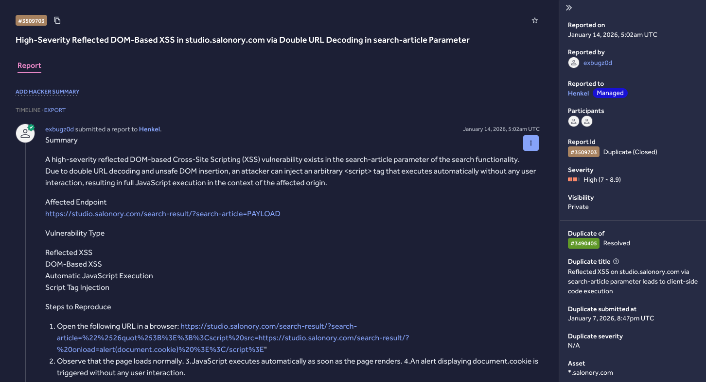

# Reflected DOM-Based XSS — Henkel VDP (HackerOne)

## Summary
A high-severity **Reflected DOM-Based Cross-Site Scripting (XSS)** vulnerability was identified in the `search-article` parameter of the search functionality on `studio.salonory.com`. Due to **double URL decoding** combined with **unsafe DOM insertion**, an attacker could inject an arbitrary `<script>` tag that executes automatically with no user interaction, resulting in full JavaScript execution in the context of the affected origin.

- **Program / Platform:** Henkel VDP — HackerOne
- **Vulnerability Type:** Reflected XSS, DOM-Based XSS, Script Tag Injection, Automatic JavaScript Execution
- **Severity:** High
- **Status:** Duplicate (previously reported)

## Affected Endpoint
```
https://studio.salonory.com/search-result/?search-article=PAYLOAD
```

## Technical Details

The application performs **multiple passes of URL decoding** on the `search-article` parameter before inserting the value into the DOM (via an unsafe sink such as `innerHTML`), without context-aware encoding. This allows an encoded payload to survive the first decode pass, unwrap during a second internal decode, and ultimately break out of its intended HTML attribute context.

**Decoding chain:**
```
%2526quot%253B → %26quot%3B → &quot; → "
```

Once decoded to a literal double quote, the payload:
1. Breaks out of the intended HTML attribute context using `"`
2. Closes the current tag using `>`
3. Injects a new `<script>` element, which the browser parses and executes immediately on page render — no click, no interaction required

## Steps to Reproduce
1. Open the affected URL in a browser with the PoC payload appended to `search-article`.
2. The page loads normally, giving no visual indication of an issue.
3. JavaScript executes automatically as the page renders.
4. An alert box displaying `document.cookie` fires without any user interaction.

## Proof of Concept Payload
```
"%2526quot%253B>%3Bscript%20src=https://studio.salonory.com/search-result/?%20onload=alert(document.cookie)%20</script>"
```

Full request example:
```
https://studio.salonory.com/search-result/?search-article=%22%2526quot%253B%3E%3B%3Cscript%20src=https://studio.salonory.com/search-result/?%20onload=alert(document.cookie)%20%3E%3C/script%3E
```

A PoC recording and screenshot are included in [`poc/`](./poc).

https://github.com/user-attachments/assets/6358ac71-26cc-4b2c-bced-5ecc13cda5f8



## Impact
If exploited, this vulnerability could allow an attacker to:
- Execute arbitrary JavaScript in a victim's browser with no interaction required
- Steal session cookies (if not protected by `HttpOnly`)
- Perform session hijacking / account takeover
- Inject phishing content into the page
- Manipulate DOM content and client-side behavior
- Chain with CSRF or other client-side attacks for greater impact

Because the script executes automatically on page load, any user who simply visits a crafted link is affected — this results in full compromise of the client-side trust boundary for the affected origin.

## Severity Justification
Rated **High** due to:
- Zero user interaction required (automatic execution on page load)
- Full JavaScript execution in the context of the vulnerable origin
- Realistic potential for session/cookie theft and account takeover

## Disclosure Status
This report was marked as a **Duplicate** on HackerOne, meaning the issue had already been reported by another researcher prior to this submission. It is included here for portfolio/research documentation purposes, in line with HackerOne's disclosure policies for the Henkel program.

## Credit
Reported by [Ahmed Alsiddig](https://www.linkedin.com/in/ahmed-alsiddig-6a0801287/) via HackerOne.
