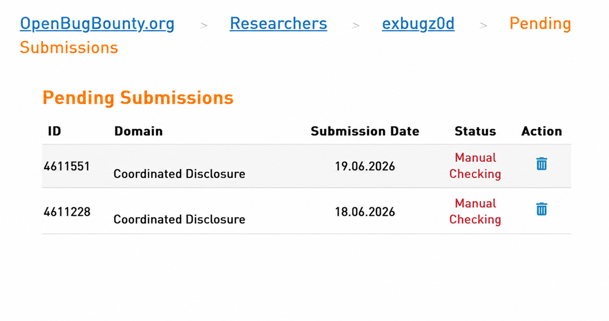

# 2FA Bypass via Direct Navigation to Authenticated Dashboard — Facturaz (OpenBugBounty)

## Summary
A **Two-Factor Authentication (2FA) bypass** vulnerability existed in the authentication flow of Facturaz. After submitting valid credentials for an account with 2FA enabled, an attacker could directly access the authenticated dashboard **without providing the required 2FA verification code**, simply by modifying the URL before completing the second authentication step.

- **Program / Platform:** Facturaz — OpenBugBounty
- **Vulnerability Type:** Authentication Bypass / Two-Factor Authentication Bypass
- **Severity:** High (CVSS 9.4 — Critical, see below)
- **Status:** Fixed

## Affected URL
```
https://facturaz.es/en?auth=login
```

## Description
When a user with 2FA enabled logs in using a standard username/password account (not OAuth via Google or Apple), the application correctly redirects to the 2FA verification page.

However, before entering the 2FA code, it was possible to manually modify the browser URL and navigate directly to the authenticated dashboard. The application granted access without validating that the second authentication factor had been completed — effectively allowing full account access after only the primary credential check.

## Steps to Reproduce

**Prerequisites:**
- A valid user account
- Two-Factor Authentication enabled on the account
- Login via standard username/password (not Google or Apple OAuth)

**Reproduction steps:**
1. Navigate to `https://facturaz.es/en?auth=login`.
2. Enter valid account credentials and submit the login form.
3. The application redirects to the 2FA verification page, requesting the authentication code.
4. Before entering the 2FA code, modify the browser URL.
5. Replace `?auth=login` with `/app/dashboard?_rsc=17fxo`.
6. Visit the modified URL.
7. Observe that the application grants direct access to the authenticated dashboard, without requiring successful completion of the 2FA challenge.

### Expected Result
The application should deny access to all authenticated resources until the user successfully completes 2FA verification. Users who have not completed 2FA should remain restricted to the verification flow.

### Actual Result
The application allowed direct access to the authenticated dashboard before successful 2FA verification — a complete bypass of the second authentication factor.

## Impact
An attacker who has obtained valid user credentials (e.g. via phishing, credential stuffing, or a data breach) could gain **full access to a 2FA-protected account** without possessing the victim's second factor. This defeats the purpose of 2FA and significantly reduces account security.

Potential impacts include:
- Unauthorized account access
- Access to sensitive business information
- Modification of account settings and data
- Complete compromise of accounts relying on 2FA for protection

## Root Cause
The application relied on client-side routing/redirects to enforce the 2FA step, rather than validating 2FA completion server-side on every request to authenticated resources.

## Severity — CVSS v3.1
**Base Score: 9.4 (Critical)**
```
Vector: AV/AC/PR/UI/S/C/I/A
```
The vulnerability allows bypass of a security control designed to protect authenticated accounts and may lead to complete account compromise when valid credentials are known.

## Proof of Concept
A video PoC demonstrating the following is included in [`poc/`](./poc):
1. Logging in with a 2FA-enabled account
2. Reaching the 2FA verification page
3. Modifying the URL before entering the verification code
4. Accessing the dashboard directly without completing 2FA

https://github.com/user-attachments/assets/cfd08849-6b24-47dd-99dd-9dcfbdc62987

## Suggested Remediation
- Maintain server-side authentication state indicating whether 2FA has been successfully completed
- Verify 2FA completion on every request to authenticated resources
- Prevent access to protected routes until the 2FA verification process is completed
- Implement middleware that validates 2FA status before serving authenticated pages
- Do not rely solely on client-side routing or redirects to enforce 2FA requirements

## Timeline
| Date | Event |
|------|-------|
| 2026-06-18 | Reported via OpenBugBounty (Submission ID 4611228) |

Submission evidence (OpenBugBounty dashboard):



## Disclosure Status
This report was submitted through OpenBugBounty. **The vendor did not respond at any point during the process** and subsequently exited the OpenBugBounty platform. The vulnerability was later confirmed to be fixed, but without any acknowledgment, communication, or coordination from the vendor.

No responsible disclosure agreement or embargo period was established by the vendor, and this write-up is published in line with OpenBugBounty's standard disclosure policy for unresponsive vendors.

## Credit
Reported by [Ahmed Alsiddig](https://www.linkedin.com/in/ahmed-alsiddig-6a0801287/) via OpenBugBounty.
