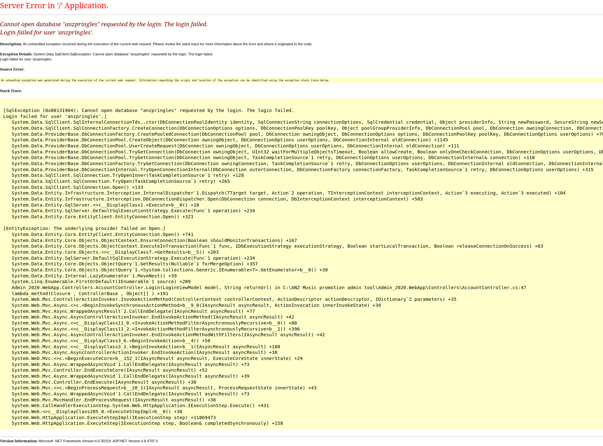

# Unauthenticated ASP.NET Exception Disclosure — Mars VDP (HackerOne)

## Summary
The admin login panel at `admin.promo.pringles.com` exposes **detailed ASP.NET error messages and full stack traces to unauthenticated users** when submitting any arbitrary username/password combination. The exposed exception reveals sensitive internal information, including the database name, database username, application architecture, framework versions, internal filesystem paths, controller names, and source code locations — all without valid credentials.

- **Program / Platform:** Mars — HackerOne
- **Vulnerability Type:** Information Disclosure / Verbose Error Handling
- **Severity:** Informative
- **Status:** Duplicate of Informative (report #3899408)
- **Reported:** 2026-08-21

## Affected Endpoint
```
https://admin.promo.pringles.com
```

## Steps to Reproduce
1. Navigate to the administrative login page.
2. Enter any arbitrary credentials, e.g.:
   - Username: `admin`
   - Password: `admin`
3. Submit the login request.
4. Observe that the application returns a detailed ASP.NET error page containing internal application information.
5. Repeat with a different arbitrary credential pair (e.g. `test123` / `password123`) — the same error is returned, confirming no valid authentication is required to trigger the disclosure.

## Observed Response
The application returns an unhandled exception resembling:
```
Server Error in '/' Application.
Cannot open database "anzpringles" requested by the login.
The login failed.
Login failed for user 'anzpringles'.
```

The response also exposes an internal source path:
```
C:\ANZ Music promotion admin tool\Admin_2020.WebApp\Controllers\AccountController.cs:47
```

## Information Disclosed
**Database information**
- Database name: `anzpringles`
- Database login username: `anzpringles`

**Internal application structure**
- `Admin_2020.WebApp`
  - `Controllers`
    - `AccountController.cs`

**Source code location**
- `AccountController.cs:47`

**Technology stack revealed**
- ASP.NET MVC
- .NET Framework (version disclosed in the trace)
- Entity Framework
- `System.Data.SqlClient`
- Microsoft SQL Server backend

## Root Cause
The application is configured to display detailed ASP.NET error messages to clients. Unhandled exceptions are returned directly to the user instead of being caught and replaced with a generic error page — i.e. `customErrors` / debug mode is not properly disabled in production.

## Impact
An unauthenticated attacker can collect sensitive internal information about the application's infrastructure, including:
- Database naming conventions
- Internal project structure
- Application framework details
- Source code organization
- Potential attack surface locations

This issue does not by itself provide database access or an authentication bypass, but it significantly reduces the reconnaissance effort required for an attacker to plan targeted attacks against the application.

## Suggested Remediation
1. Disable detailed ASP.NET errors in production:
   ```xml
   <customErrors mode="On" />
   ```
   or
   ```xml
   <compilation debug="false" />
   ```
2. Implement custom error handling that returns generic messages to users (e.g. "An unexpected error occurred. Please try again later.").
3. Log detailed exceptions internally rather than exposing them to clients.
4. Review application configuration to confirm debug mode is disabled in production.
5. Avoid exposing stack traces, filesystem paths, database names, internal usernames, and source code locations in any client-facing response.

## Proof of Concept
A screenshot of the disclosed error response is included in [`poc/`](./poc).



## Timeline
| Date | Event |
|------|-------|
| 2026-08-21 | Reported via HackerOne |
| 2026-08-21 | Triaged and closed as Duplicate of report #3899408 (originally assessed as Informative) |

## Disclosure Status
This report was closed as a **Duplicate** of an earlier report (#3899408), which had already been evaluated and closed as **Informative**. Included here for portfolio/research documentation, in line with HackerOne's disclosure policy for the Mars program.

## Credit
Reported by [Ahmed Alsiddig](https://www.linkedin.com/in/ahmed-alsiddig-6a0801287/) via HackerOne.
